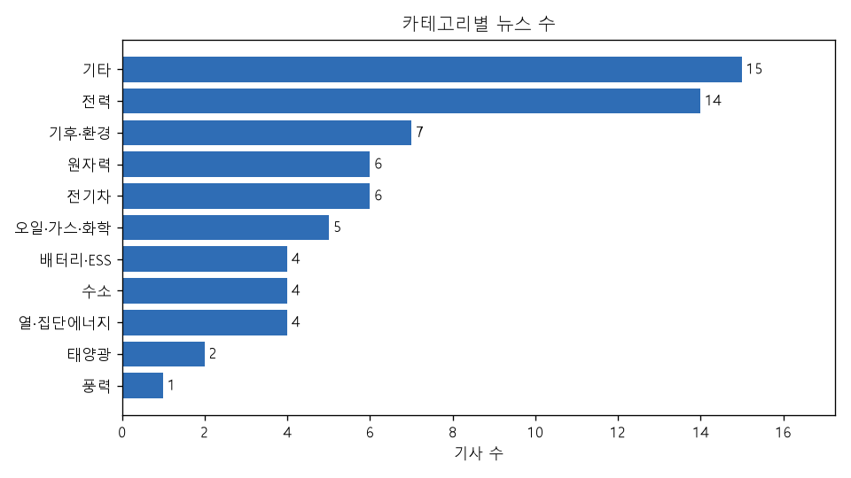
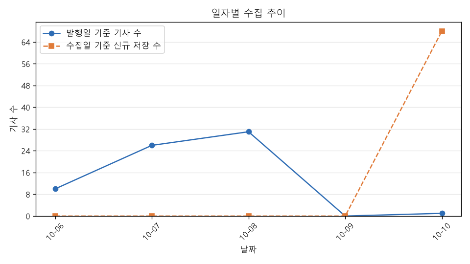
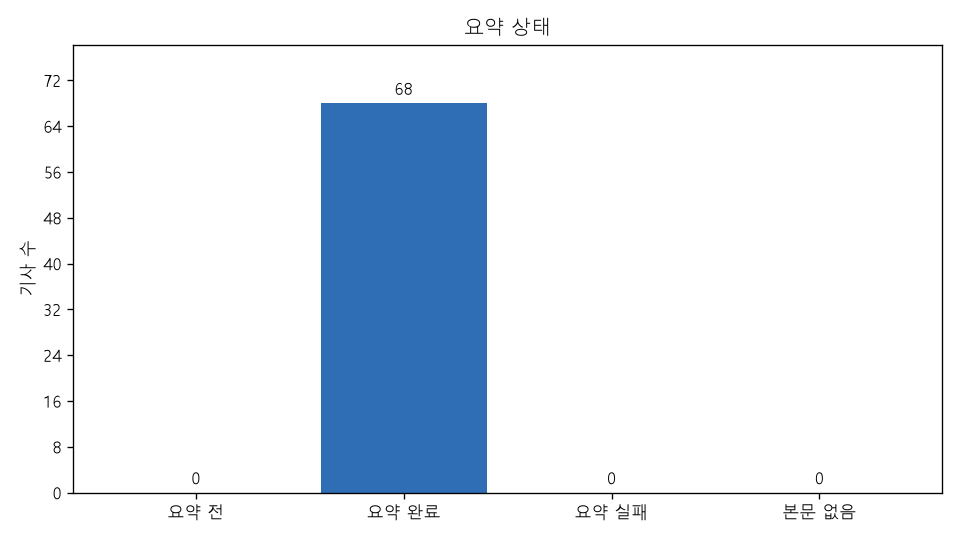

# 에너지 뉴스 트렌드 리포트

## 1. 조건과 생성 시각

- 생성 시각: 2026-10-10 20:21:38 (한국 시간)
- 조건: 기간 전체, 카테고리 전체
- 대상 기사: 68건 (발행일 2026-10-06 ~ 2026-10-10)
- 출처: 전기신문 (https://www.electimes.com) — 기사 본문은 싣지 않고 제목·링크·AI 요약·분석만 싣는다

## 2. 품질 지표

| 지표 | 값 | 계산 | 기준 |
|---|---|---|---|
| 수집 성공률 | 100.0% (81/81) | 성공한 HTTP 요청 ÷ (성공 + 실패) | 전체 실행 |
| 정제 통과율 | 100.0% (128/128) | 검증을 통과한 raw ÷ 정제한 raw | 전체 실행 |
| 중복 비율 | 0.0% (0/128) | 중복으로 건너뛴 raw ÷ 정제한 raw | 전체 실행 |
| 본문 확보율 | 100.0% (68/68) | 크롤링 본문이 있는 기사 ÷ 전체 기사 | 조건 기사 |
| 요약 완료율 | 100.0% (68/68) | 요약 완료 기사 ÷ 본문이 있는 기사 | 조건 기사 |
| AI 요약 실패율 | 0.0% (0/68) | 요약 실패 기록 ÷ (요약 저장 + 요약 실패 기록) | 조건 기사 |
| 평균 압축률 | 16.6% (14,948/90,245) | 요약 글자 수 ÷ 요약에 넣은 본문 글자 수 (기사별 최신 요약) | 조건 기사 |

- 수집 성공률·정제 통과율·중복 비율은 fetch·clean 전체 실행 기준, 나머지는 조건에 맞는 기사 기준

## 3. TOP 5

### 카테고리 TOP 5

| 순위 | 카테고리 | 기사 수 |
|---|---|---|
| 1 | 기타 | 15 |
| 2 | 전력 | 14 |
| 3 | 기후·환경 | 7 |
| 4 | 원자력 | 6 |
| 5 | 전기차 | 6 |

### 키워드 TOP 5 (기사별 최신 요약의 키워드, 기사당 1회)

| 순위 | 키워드 | 기사 수 |
|---|---|---|
| 1 | K-GX | 4 |
| 2 | 한국지역난방공사 | 4 |
| 3 | HVDC | 3 |
| 4 | 수소환원제철 | 3 |
| 5 | 에너지저장장치(ESS) | 3 |

### 기자 TOP 5

| 순위 | 기자 | 기사 수 |
|---|---|---|
| 1 | 김부미 기자 | 10 |
| 2 | 정세영 기자 | 8 |
| 3 | 오유진 기자 | 7 |
| 4 | 정재원 기자 | 6 |
| 5 | 차기영 기자 | 6 |

## 4. AI 인사이트

- 분석 #1 (2026-10-10 20:21:02, gemini-3-flash, 기사 40건, 조건: 기간 전체, 카테고리 전체)

### 주요 트렌드

1. **전력망 현대화 및 HVDC 기술 자립화 가속** — 서해안 에너지고속도로를 위한 HVDC 성능 검증 설비 구축과 대규모 해저케이블 입찰 등 전력 인프라 시장이 확대되고 있습니다.
   - 근거 [7] [[단독] 케이블사 알력에 발목 잡힐라...서해안 HVDC 케이블 입찰방안 사전공개](https://www.electimes.com/news/articleView.html?idxno=373195)
   - 근거 [43] [韓-이집트, 태양광·풍력 넘어 송배전망·HVDC 협력 확대](https://www.electimes.com/news/articleView.html?idxno=373239)
   - 근거 [46] [에너지 고속도로 기술 자립화 시동… 효성중공업, GW급 HVDC 성능 검증설비 국내 첫 구축](https://www.electimes.com/news/articleView.html?idxno=373232)
   - 근거 [54] [LS일렉트릭, 대만 포모사와 합작법인 설립… 전력 인프라 시장 공략 본격화](https://www.electimes.com/news/articleView.html?idxno=373182)
2. **AI(AX) 기반 에너지 설계 및 관리 시스템 도입** — 원전 설계, 전력 보안, 홈에너지 플랫폼 등 에너지 산업 전반에 AI 기술을 접목하여 효율성을 높이는 AX 전환이 본격화되고 있습니다.
   - 근거 [9] [가스안전공사, 내부정보 무단접속 재발 막는다…보안체계 전면 점검](https://www.electimes.com/news/articleView.html?idxno=373191)
   - 근거 [10] [50년 원전 설계 자산 AI로…한국전력기술, ‘반디’에 적용](https://www.electimes.com/news/articleView.html?idxno=373188)
   - 근거 [21] [헤리트, 홈에너지 플랫폼 ‘케이와트’ 12일 출시… 100만 가구·EV 묶는다](https://www.electimes.com/news/articleView.html?idxno=373225)
   - 근거 [50] [KTC 기계ISC, ‘AI 융합산업 HRD포럼’ 공동 개최](https://www.electimes.com/news/articleView.html?idxno=373210)
3. **수소 생태계 확장을 위한 원천 기술 및 협력 강화** — 수소환원제철 브릿지 기술 개발과 고효율 수전해 촉매 연구, 청정메탄올 연계 등 탄소중립을 위한 수소 밸류체인 구축이 진행 중입니다.
   - 근거 [27] [“수소환원제철의 관건은 수소 공급”...포스텍·RIST ‘Ferro-H₂’ 개발](https://www.electimes.com/news/articleView.html?idxno=373219)
   - 근거 [29] [수소산업협회-청정메탄올산업협회, 수소·청정메탄올 산업 활성화 위해 맞손](https://www.electimes.com/news/articleView.html?idxno=373193)
   - 근거 [30] [“귀한 이리듐 대신 식물이 선택한 망간으로” ..고성능 망간 수전해 촉매 개발](https://www.electimes.com/news/articleView.html?idxno=373202)
   - 근거 [31] [머리카락 굵기보다 수천 배 얇은 두께 코팅으로 ‘빠르고 오래가는’ 수전해 촉매 구현!](https://www.electimes.com/news/articleView.html?idxno=373201)
4. **에너지 취약계층 지원 및 지역 상생 ESG 활동 확대** — 난방비 지원, 실명 예방 의료비 지원, 전통시장 안전 용품 보급 등 공기업과 민간 기업의 사회적 책임 활동이 강화되고 있습니다.
   - 근거 [2] [한난, ‘우리 동네 온기 가득’으로 지역 에너지·환경 문제 해결](https://www.electimes.com/news/articleView.html?idxno=373247)
   - 근거 [3] [한전, 눈 건강 사회공헌 공로 인정…보건복지부 장관상 수상](https://www.electimes.com/news/articleView.html?idxno=373245)
   - 근거 [12] [한난, 취약계층 난방비 104억원 지원…대상 15% 확대](https://www.electimes.com/news/articleView.html?idxno=373186)
   - 근거 [51] [에너지공단, 대구 명덕시장에 화재 예방용품 지원...불법촬영 점검도](https://www.electimes.com/news/articleView.html?idxno=373197)
   - 근거 [55] [에코프로, 청원생명축제 입장권 2000매 구매…지역경제 활성화 동참](https://www.electimes.com/news/articleView.html?idxno=373179)
5. **전기차의 디지털 공간 진화 및 전동화 시장 성장** — 전기차를 게임 플랫폼으로 활용하는 인포테인먼트 경쟁과 함께 하이브리드 모델의 인기 및 수입 전동화 모델 1만 대 돌파 등 시장이 성숙하고 있습니다.
   - 근거 [41] [‘전기차는 게임기다’…현대차·BMW가 게임쇼로 간 까닭은](https://www.electimes.com/news/articleView.html?idxno=373196)
   - 근거 [52] [KGM 액티언 하이브리드, 전 연령대서 80% 이상 선택받아](https://www.electimes.com/news/articleView.html?idxno=373199)
   - 근거 [53] [BMW 코리아, 전동화 1만대 첫 돌파…수입 프리미엄 최초](https://www.electimes.com/news/articleView.html?idxno=373198)

### 핵심 키워드

1. **HVDC** — 서해안 에너지고속도로와 글로벌 전력망 협력의 핵심 기술로 부상함
2. **AI(AX)** — 에너지 설계, 보안, 인력 양성 등 전 분야의 효율화를 이끄는 동력임
3. **햇빛소득마을** — 지역 주민 주도의 태양광 사업 모델이 전국적으로 대폭 확대됨
4. **수소 촉매** — 그린수소 생산 단가를 낮추고 내구성을 높이는 원천 기술 개발이 활발함
5. **회피배출(Scope 4)** — 저탄소 제품의 기후 성과를 측정하는 새로운 환경 지표로 주목받음
6. **VPP(가상발전소)** — 전력 수급 안정을 위한 분산에너지 자원 통합 관리의 핵심 수단임
7. **에너지 복지** — 취약계층 난방비 지원 및 사회적 약자를 위한 맞춤형 공헌 활동이 지속됨
8. **원전 인력** — 원전 수출 성과와 달리 전문 인력 부족이 산업 성장의 발목을 잡는 리스크로 지적됨

### 공통점·차이점

**공통점**
- 탄소중립 달성을 위해 AI 기술을 활용한 지능형 에너지 관리와 신재생에너지 인프라 구축에 집중하고 있습니다.

**차이점**
- 원자력과 전력 분야는 인력 수급과 계통 안정을 고민하는 반면, 전기차와 수소 분야는 서비스 플랫폼화와 촉매 기술 등 신시장 선점 경쟁에 주력하고 있습니다.

### 시사점

1. 원전 르네상스 및 전력망 확대를 뒷받침하기 위해 전문 인력 양성과 계통 연계 문제를 조속히 해결해야 합니다.
2. EU 메탄규제와 회피배출(Scope 4) 국제표준 등 글로벌 환경 규제 변화에 대응한 국내 기업들의 선제적 전략 마련이 필요합니다.
3. 송배전망 현대화와 HVDC 기술 자립화는 국내 재생에너지 수급 불균형 해소와 해외 시장 진출의 핵심 경쟁력이 될 전망입니다.

## 5. 차트

### 카테고리별 뉴스 수

### 일자별 수집 추이

### 요약 상태

