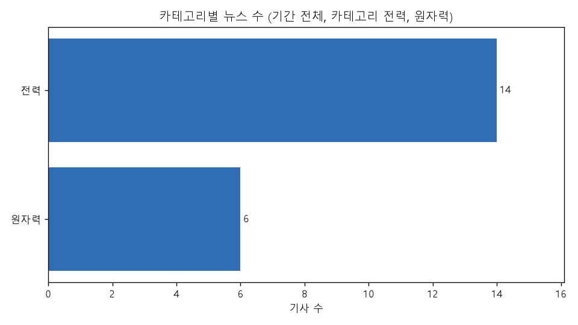
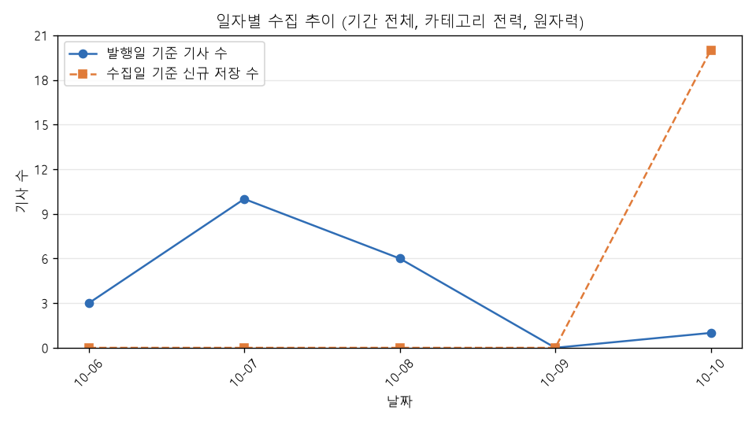
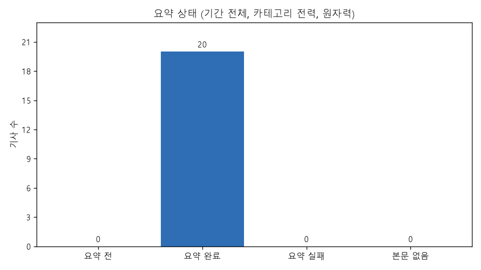

# 에너지 뉴스 트렌드 리포트

## 1. 조건과 생성 시각

- 생성 시각: 2026-10-10 20:21:43 (한국 시간)
- 조건: 기간 전체, 카테고리 전력, 원자력
- 대상 기사: 20건 (발행일 2026-10-06 ~ 2026-10-10)
- 출처: 전기신문 (https://www.electimes.com) — 기사 본문은 싣지 않고 제목·링크·AI 요약·분석만 싣는다

## 2. 품질 지표

| 지표 | 값 | 계산 | 기준 |
|---|---|---|---|
| 수집 성공률 | 100.0% (81/81) | 성공한 HTTP 요청 ÷ (성공 + 실패) | 전체 실행 |
| 정제 통과율 | 100.0% (128/128) | 검증을 통과한 raw ÷ 정제한 raw | 전체 실행 |
| 중복 비율 | 0.0% (0/128) | 중복으로 건너뛴 raw ÷ 정제한 raw | 전체 실행 |
| 본문 확보율 | 100.0% (20/20) | 크롤링 본문이 있는 기사 ÷ 전체 기사 | 조건 기사 |
| 요약 완료율 | 100.0% (20/20) | 요약 완료 기사 ÷ 본문이 있는 기사 | 조건 기사 |
| AI 요약 실패율 | 0.0% (0/20) | 요약 실패 기록 ÷ (요약 저장 + 요약 실패 기록) | 조건 기사 |
| 평균 압축률 | 16.0% (4,487/27,990) | 요약 글자 수 ÷ 요약에 넣은 본문 글자 수 (기사별 최신 요약) | 조건 기사 |

- 수집 성공률·정제 통과율·중복 비율은 fetch·clean 전체 실행 기준, 나머지는 조건에 맞는 기사 기준

## 3. TOP 5

### 카테고리 TOP 5

| 순위 | 카테고리 | 기사 수 |
|---|---|---|
| 1 | 전력 | 14 |
| 2 | 원자력 | 6 |

### 키워드 TOP 5 (기사별 최신 요약의 키워드, 기사당 1회)

| 순위 | 키워드 | 기사 수 |
|---|---|---|
| 1 | HVDC | 2 |
| 2 | 생성형 AI | 2 |
| 3 | 에너지저장장치(ESS) | 2 |
| 4 | 전력거래소 | 2 |
| 5 | 한국전력 | 2 |

### 기자 TOP 5

| 순위 | 기자 | 기사 수 |
|---|---|---|
| 1 | 정세영 기자 | 7 |
| 2 | 김부미 기자 | 6 |
| 3 | 윤대원 기자 | 3 |
| 4 | 김진후 기자 | 1 |
| 5 | 오승지 기자 | 1 |

## 4. AI 인사이트

- 분석 #2 (2026-10-10 20:21:15, gemini-3-flash, 기사 20건, 조건: 기간 전체, 카테고리 전력, 원자력)

### 주요 트렌드

1. **전력망 인프라 확충 및 HVDC 기술 고도화** — 서해안 HVDC 사업의 본격 추진과 함께 한전의 차세대 제어기술 연구성과가 국제적으로 인정받는 등 안정적 전력 공급을 위한 송전망 고도화가 핵심 과제로 부상했다.
   - 근거 [7] [[단독] 케이블사 알력에 발목 잡힐라...서해안 HVDC 케이블 입찰방안 사전공개](https://www.electimes.com/news/articleView.html?idxno=373195)
   - 근거 [43] [韓-이집트, 태양광·풍력 넘어 송배전망·HVDC 협력 확대](https://www.electimes.com/news/articleView.html?idxno=373239)
   - 근거 [58] [“태양광·풍력·SMR·HVDC”…K-GX, 에너지산업 공급망까지 ‘대수술’](https://www.electimes.com/news/articleView.html?idxno=373158)
   - 근거 [61] [한전, 차세대 전압형 HVDC 분석기술 연구성과 국제학술지 게재](https://www.electimes.com/news/articleView.html?idxno=373151)
2. **에너지 산업 전반의 AI 및 디지털 전환(AX) 가속화** — 원전 설계 자산의 데이터화, AI 기반 유연탄 수급 예측, 신재생 인프라 보안 강화 등 에너지 전 분야에서 AI와 디지털 기술을 통한 운영 효율화가 진행 중이다.
   - 근거 [10] [50년 원전 설계 자산 AI로…한국전력기술, ‘반디’에 적용](https://www.electimes.com/news/articleView.html?idxno=373188)
   - 근거 [14] [한전KDN, 신재생 인프라 사이버 보안 강화 나서](https://www.electimes.com/news/articleView.html?idxno=373175)
   - 근거 [64] [서부발전, AI로 유연탄 수급 90일 예측…통합관제 가동](https://www.electimes.com/news/articleView.html?idxno=373086)
3. **원전 르네상스 도래와 전문인력 수급 불균형** — 신규 원전 건설과 수출 사업이 급증하며 산업 활기가 돌고 있으나, 2029년까지 3,556명의 추가 인력이 필요한 상황에서 전공생 감소로 인한 인력난이 사업 차질의 우려 요인이 되고 있다.
   - 근거 [1] [원전 르네상스 왔는데…“일할 사람이 없다” 전문인력 부족에 발목](https://www.electimes.com/news/articleView.html?idxno=373217)
   - 근거 [18] [원전수출 컨트롤타워 민관 협력 강화…‘원전수출 리더스포럼’ 출범](https://www.electimes.com/news/articleView.html?idxno=373160)
4. **전력시장 제도 개편을 둘러싼 이해관계 갈등** — 지역별 도매가격제(LMP) 도입과 SMP 결정 구조 왜곡에 대해 민간 발전사들이 수익성 악화를 우려하며 법적 대응을 예고하는 등 시장 규칙 개편을 둘러싼 진통이 이어지고 있다.
   - 근거 [4] [이상한 전력시장…비싼 LNG 더 돌리고도 SMP 56원 ‘뚝’](https://www.electimes.com/news/articleView.html?idxno=373223)
   - 근거 [19] [계통제약에 LMP까지…민자석탄이 유독 민감한 이유](https://www.electimes.com/news/articleView.html?idxno=373154)
   - 근거 [62] [망 막혀야 전기요금 할인재원 커진다?…지역별 요금의 아이러니](https://www.electimes.com/news/articleView.html?idxno=373133)

### 핵심 키워드

1. **HVDC** — 서해안 송전망 구축과 차세대 제어기술 연구 등 국가 전력망 확충의 핵심 기술로 부각됨
2. **AI (인공지능)** — 원전 설계부터 연료 수급 예측까지 에너지 산업의 효율성 극대화를 위한 필수 도구로 활용됨
3. **LMP (지역별 도매가격제)** — 전력 구입비 절감과 지역 요금 할인 재원 마련을 위한 핵심 제도이나 이해관계자 갈등의 중심에 있음
4. **인력 부족** — 국내외 원전 사업 확대에 따른 수요 급증에도 불구하고 전문인력 공급이 이를 따라가지 못하는 상황임
5. **SMR (소형모듈원자로)** — 해양용 및 i-SMR 도입 등 차세대 원전 기술로서 정부의 에너지 공급망 혁신 전략의 핵심임
6. **수출 산업화** — 원전, 가스터빈, 전력 기기 등 국산 에너지 기술의 북미 및 아시아 시장 진출이 가속화되고 있음

### 공통점·차이점

**공통점**
- 두 카테고리 모두 AI 등 최첨단 기술을 도입하여 설계 및 운영 효율성을 높이려는 기술 혁신 기조를 공유하고 있다.
- 정부의 에너지 정책 방향에 맞춰 국산 기술의 고도화와 글로벌 시장 수출 확대를 주요 목표로 삼고 있다.

**차이점**
- 원자력은 전문인력 부족과 사회적 합의(공론화)가 주요 현안인 반면, 전력 분야는 시장 가격(SMP, LMP) 왜곡과 제도적 보완책 마련에 집중하고 있다.
- 원자력은 대규모 설비 건설과 장기적인 수급 계획에 중점을 두는 반면, 전력은 재생에너지 변동성에 대응하기 위한 유연성 자원(DR, ESS) 확보에 주력하고 있다.

### 시사점

1. 원전 수출 성과가 실질적인 산업 경쟁력으로 이어지기 위해서는 건설 계획과 병행되는 체계적인 인력 양성 대책 및 민관 협력 컨트롤타워 강화가 필수적이다.
2. LMP 도입 등 전력시장 개편 시 송전망 투자 유인 저하와 같은 구조적 모순을 방지하기 위해 혼잡수익 설계 등 정교한 보완책 마련이 요구된다.
3. 재생에너지 공급 과잉 시대를 대비하여 경직된 가격 신호를 개선하고, VPP와 ESS 등 유연성 자원에 대한 현실적인 보상 체계를 구축해야 한다.

## 5. 차트

### 카테고리별 뉴스 수

### 일자별 수집 추이

### 요약 상태

