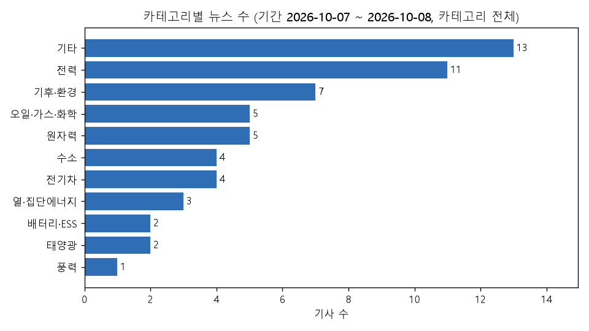
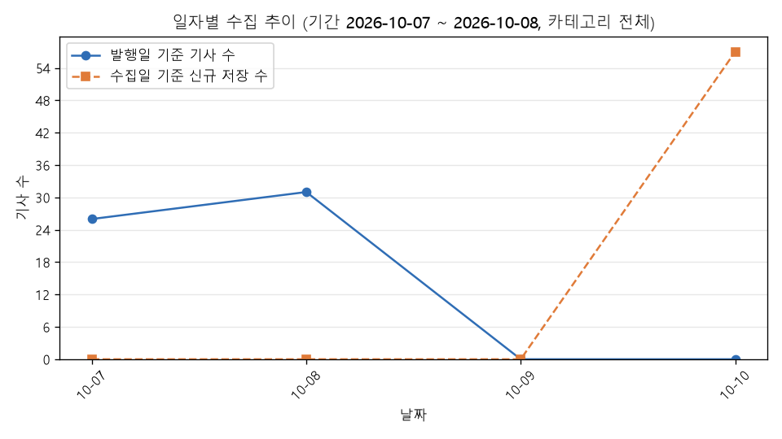
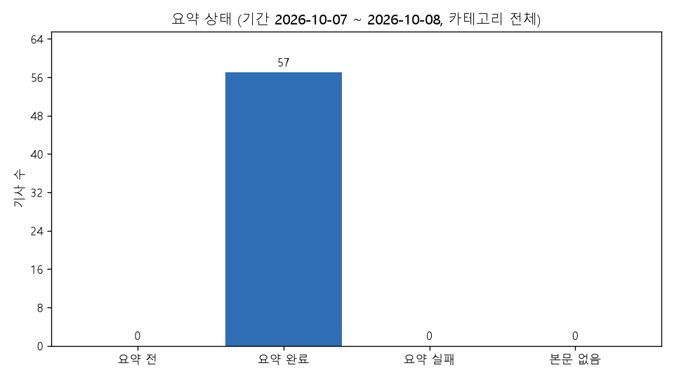

# 에너지 뉴스 트렌드 리포트

## 1. 조건과 생성 시각

- 생성 시각: 2026-10-10 20:21:45 (한국 시간)
- 조건: 기간 2026-10-07 ~ 2026-10-08, 카테고리 전체
- 대상 기사: 57건 (발행일 2026-10-07 ~ 2026-10-08)
- 출처: 전기신문 (https://www.electimes.com) — 기사 본문은 싣지 않고 제목·링크·AI 요약·분석만 싣는다

## 2. 품질 지표

| 지표 | 값 | 계산 | 기준 |
|---|---|---|---|
| 수집 성공률 | 100.0% (81/81) | 성공한 HTTP 요청 ÷ (성공 + 실패) | 전체 실행 |
| 정제 통과율 | 100.0% (128/128) | 검증을 통과한 raw ÷ 정제한 raw | 전체 실행 |
| 중복 비율 | 0.0% (0/128) | 중복으로 건너뛴 raw ÷ 정제한 raw | 전체 실행 |
| 본문 확보율 | 100.0% (57/57) | 크롤링 본문이 있는 기사 ÷ 전체 기사 | 조건 기사 |
| 요약 완료율 | 100.0% (57/57) | 요약 완료 기사 ÷ 본문이 있는 기사 | 조건 기사 |
| AI 요약 실패율 | 0.0% (0/57) | 요약 실패 기록 ÷ (요약 저장 + 요약 실패 기록) | 조건 기사 |
| 평균 압축률 | 16.5% (12,464/75,469) | 요약 글자 수 ÷ 요약에 넣은 본문 글자 수 (기사별 최신 요약) | 조건 기사 |

- 수집 성공률·정제 통과율·중복 비율은 fetch·clean 전체 실행 기준, 나머지는 조건에 맞는 기사 기준

## 3. TOP 5

### 카테고리 TOP 5

| 순위 | 카테고리 | 기사 수 |
|---|---|---|
| 1 | 기타 | 13 |
| 2 | 전력 | 11 |
| 3 | 기후·환경 | 7 |
| 4 | 오일·가스·화학 | 5 |
| 5 | 원자력 | 5 |

### 키워드 TOP 5 (기사별 최신 요약의 키워드, 기사당 1회)

| 순위 | 키워드 | 기사 수 |
|---|---|---|
| 1 | K-GX | 4 |
| 2 | HVDC | 3 |
| 3 | 수소환원제철 | 3 |
| 4 | 에너지저장장치(ESS) | 3 |
| 5 | 한국지역난방공사 | 3 |

### 기자 TOP 5

| 순위 | 기자 | 기사 수 |
|---|---|---|
| 1 | 김부미 기자 | 9 |
| 2 | 오유진 기자 | 7 |
| 3 | 윤대원 기자 | 5 |
| 4 | 윤재현 기자 | 5 |
| 5 | 정세영 기자 | 5 |

## 4. AI 인사이트

- 분석 #3 (2026-10-10 20:21:27, gemini-3-flash, 기사 40건, 조건: 기간 2026-10-07 ~ 2026-10-08, 카테고리 전체)

### 주요 트렌드

1. **전력 계통 안정화를 위한 HVDC 기술 자립 및 인프라 확충** — 서해안 에너지고속도로 등 재생에너지 송전을 위해 2GW급 HVDC 검증 설비를 구축하고 해저케이블 입찰을 추진하며 전력망 현대화에 집중하고 있습니다.
   - 근거 [46] [에너지 고속도로 기술 자립화 시동… 효성중공업, GW급 HVDC 성능 검증설비 국내 첫 구축](https://www.electimes.com/news/articleView.html?idxno=373232)
   - 근거 [7] [[단독] 케이블사 알력에 발목 잡힐라...서해안 HVDC 케이블 입찰방안 사전공개](https://www.electimes.com/news/articleView.html?idxno=373195)
   - 근거 [43] [韓-이집트, 태양광·풍력 넘어 송배전망·HVDC 협력 확대](https://www.electimes.com/news/articleView.html?idxno=373239)
   - 근거 [54] [LS일렉트릭, 대만 포모사와 합작법인 설립… 전력 인프라 시장 공략 본격화](https://www.electimes.com/news/articleView.html?idxno=373182)
2. **에너지 산업 전반의 AX(AI 전환) 및 디지털 플랫폼화** — 원전 설계, 보안 관제, 도시 조명, 전기차 인포테인먼트 등 다양한 분야에서 AI와 디지털 기술을 접목해 효율성을 높이고 사용자 경험을 혁신하고 있습니다.
   - 근거 [10] [50년 원전 설계 자산 AI로…한국전력기술, ‘반디’에 적용](https://www.electimes.com/news/articleView.html?idxno=373188)
   - 근거 [9] [가스안전공사, 내부정보 무단접속 재발 막는다…보안체계 전면 점검](https://www.electimes.com/news/articleView.html?idxno=373191)
   - 근거 [48] [(서울 아시아 도시조명 컨퍼런스) 도시조명과 에너지 절약, 야간경제, AI 등 다양한 논의 다뤄](https://www.electimes.com/news/articleView.html?idxno=373203)
   - 근거 [41] [‘전기차는 게임기다’…현대차·BMW가 게임쇼로 간 까닭은](https://www.electimes.com/news/articleView.html?idxno=373196)
   - 근거 [50] [KTC 기계ISC, ‘AI 융합산업 HRD포럼’ 공동 개최](https://www.electimes.com/news/articleView.html?idxno=373210)
3. **그린수소 경제성 확보를 위한 차세대 촉매 및 공급 기술 개발** — 고가의 이리듐을 대체할 망간 기반 촉매나 초박막 코팅 기술, 수소환원제철을 위한 경제적 수소 공급 기술(Ferro-H₂) 개발이 활발합니다.
   - 근거 [30] [“귀한 이리듐 대신 식물이 선택한 망간으로” ..고성능 망간 수전해 촉매 개발](https://www.electimes.com/news/articleView.html?idxno=373202)
   - 근거 [31] [머리카락 굵기보다 수천 배 얇은 두께 코팅으로 ‘빠르고 오래가는’ 수전해 촉매 구현!](https://www.electimes.com/news/articleView.html?idxno=373201)
   - 근거 [27] [“수소환원제철의 관건은 수소 공급”...포스텍·RIST ‘Ferro-H₂’ 개발](https://www.electimes.com/news/articleView.html?idxno=373219)
   - 근거 [29] [수소산업협회-청정메탄올산업협회, 수소·청정메탄올 산업 활성화 위해 맞손](https://www.electimes.com/news/articleView.html?idxno=373193)
4. **에너지 복지 및 지역 상생을 통한 사회적 가치 실현** — 공기업과 민간 기업이 협력하여 취약계층 난방비 지원, 안질환 치료, 전통시장 안전 점검 및 지역 축제 지원 등 사회공헌 활동을 강화하고 있습니다.
   - 근거 [2] [한난, ‘우리 동네 온기 가득’으로 지역 에너지·환경 문제 해결](https://www.electimes.com/news/articleView.html?idxno=373247)
   - 근거 [3] [한전, 눈 건강 사회공헌 공로 인정…보건복지부 장관상 수상](https://www.electimes.com/news/articleView.html?idxno=373245)
   - 근거 [12] [한난, 취약계층 난방비 104억원 지원…대상 15% 확대](https://www.electimes.com/news/articleView.html?idxno=373186)
   - 근거 [51] [에너지공단, 대구 명덕시장에 화재 예방용품 지원...불법촬영 점검도](https://www.electimes.com/news/articleView.html?idxno=373197)
   - 근거 [55] [에코프로, 청원생명축제 입장권 2000매 구매…지역경제 활성화 동참](https://www.electimes.com/news/articleView.html?idxno=373179)

### 핵심 키워드

1. **HVDC** — 송전 제약 해소와 전력망 현대화를 위한 핵심 기술로 부각되며 기술 자립과 글로벌 진출이 추진되고 있습니다.
2. **AI/AX** — 원전 설계부터 도시 조명 제어, 산업 보안까지 에너지 산업의 디지털 전환을 주도하는 핵심 동력입니다.
3. **ESS** — LG에너지솔루션의 실적을 견인하고 전력 계통의 유연성을 확보하기 위한 필수 자원으로 활용되고 있습니다.
4. **수전해 촉매** — 그린수소 생산 단가를 낮추고 내구성을 높이기 위한 원천 기술 개발 경쟁이 치열합니다.
5. **회피배출(Scope 4)** — 제품 사용을 통해 줄인 탄소량을 측정하는 새로운 국제표준으로 시장의 주목을 받기 시작했습니다.
6. **햇빛소득마을** — 주민 참여형 태양광 사업을 통해 지역 경제 활성화와 재생에너지 확대를 동시에 도모하고 있습니다.

### 공통점·차이점

**공통점**
- AI와 디지털 기술을 도입해 공정 효율화와 안전 관리를 강화하려는 시도가 전 분야에서 공통적으로 나타납니다.
- 에너지 취약계층 지원과 지역사회 상생을 위한 공기업 및 대기업의 사회공헌 활동이 활발히 전개되고 있습니다.

**차이점**
- 전력 부문은 계통 안정과 송전 인프라 확충에 주력하는 반면, 수소·배터리 부문은 원천 소재 개발과 생산 능력 확대에 집중하고 있습니다.
- 전기차 분야는 하이브리드 모델의 높은 선호도와 게임 플랫폼화 등 사용자 경험 차별화에 무게를 두고 있습니다.

### 시사점

1. 재생에너지 확대에 따른 전력 계통 불안정 문제를 해결하기 위해 HVDC와 같은 대용량 송전 기술 및 DR(수요자원) 관리의 중요성이 더욱 커질 전망입니다.
2. EU의 메탄 규제 연기 사례처럼 에너지 안보와 환경 규제 사이의 균형을 고려한 유연한 대외 전략 수립이 필요합니다.
3. 단순 탄소 감축을 넘어 '회피배출'과 같은 정교한 환경 성과 지표가 향후 글로벌 시장 경쟁력의 새로운 척도가 될 수 있음에 대비해야 합니다.

## 5. 차트

### 카테고리별 뉴스 수

### 일자별 수집 추이

### 요약 상태

