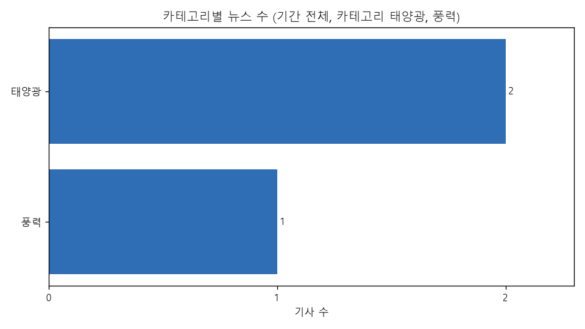
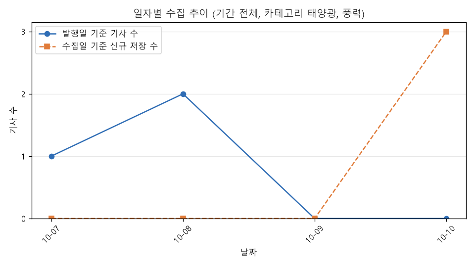
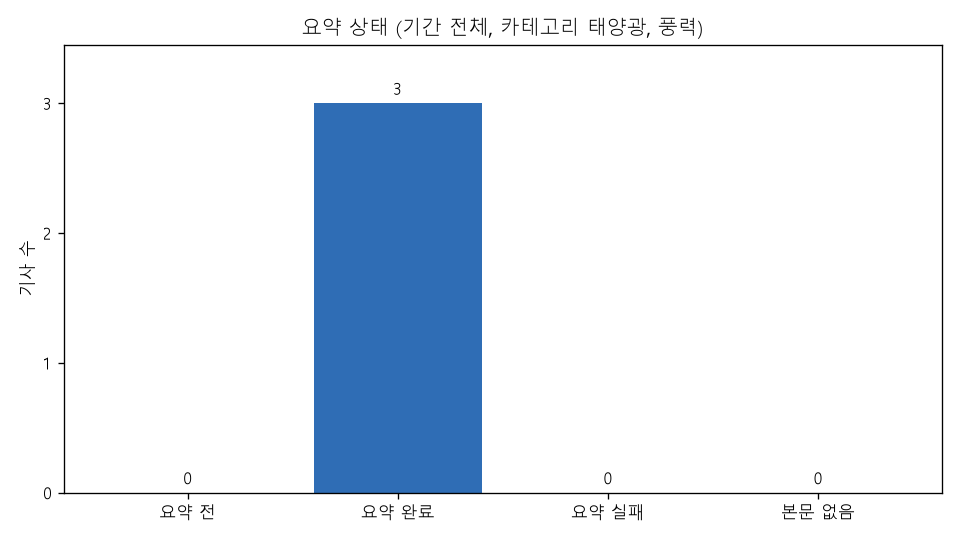

# 에너지 뉴스 트렌드 리포트

## 1. 조건과 생성 시각

- 생성 시각: 2026-10-10 20:29:04 (한국 시간)
- 조건: 기간 전체, 카테고리 태양광, 풍력
- 대상 기사: 3건 (발행일 2026-10-07 ~ 2026-10-08)
- 출처: 전기신문 (https://www.electimes.com) — 기사 본문은 싣지 않고 제목·링크·AI 요약·분석만 싣는다

## 2. 품질 지표

| 지표 | 값 | 계산 | 기준 |
|---|---|---|---|
| 수집 성공률 | 100.0% (97/97) | 성공한 HTTP 요청 ÷ (성공 + 실패) | 전체 실행 |
| 정제 통과율 | 100.0% (130/130) | 검증을 통과한 raw ÷ 정제한 raw | 전체 실행 |
| 중복 비율 | 1.5% (2/130) | 중복으로 건너뛴 raw ÷ 정제한 raw | 전체 실행 |
| 본문 확보율 | 100.0% (3/3) | 크롤링 본문이 있는 기사 ÷ 전체 기사 | 조건 기사 |
| 요약 완료율 | 100.0% (3/3) | 요약 완료 기사 ÷ 본문이 있는 기사 | 조건 기사 |
| AI 요약 실패율 | 0.0% (0/3) | 요약 실패 기록 ÷ (요약 저장 + 요약 실패 기록) | 조건 기사 |
| 평균 압축률 | 21.2% (651/3,065) | 요약 글자 수 ÷ 요약에 넣은 본문 글자 수 (기사별 최신 요약) | 조건 기사 |

- 수집 성공률·정제 통과율·중복 비율은 fetch·clean 전체 실행 기준, 나머지는 조건에 맞는 기사 기준

## 3. TOP 5

### 카테고리 TOP 5

| 순위 | 카테고리 | 기사 수 |
|---|---|---|
| 1 | 태양광 | 2 |
| 2 | 풍력 | 1 |

### 키워드 TOP 5 (기사별 최신 요약의 키워드, 기사당 1회)

| 순위 | 키워드 | 기사 수 |
|---|---|---|
| 1 | K-GX | 1 |
| 2 | 계통연계 | 1 |
| 3 | 계획입지 | 1 |
| 4 | 금융지원 | 1 |
| 5 | 마나 태양광발전소 | 1 |

### 기자 TOP 5

| 순위 | 기자 | 기사 수 |
|---|---|---|
| 1 | 김진후 기자 | 2 |
| 2 | 정세영 기자 | 1 |

## 4. AI 인사이트

> 이 조건의 분석이 없습니다. `python main.py analyze --category 태양광,풍력` 실행 후 리포트를 다시 만들거나, 저장된 분석을 `--analysis-id`로 지정하세요 (목록: `python main.py analyze --history`).

## 5. 차트

### 카테고리별 뉴스 수

### 일자별 수집 추이

### 요약 상태

